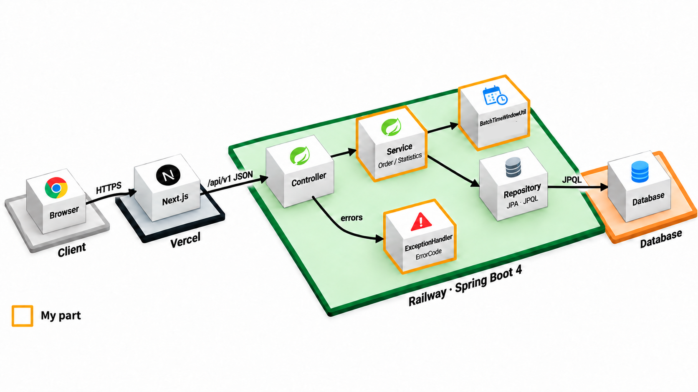
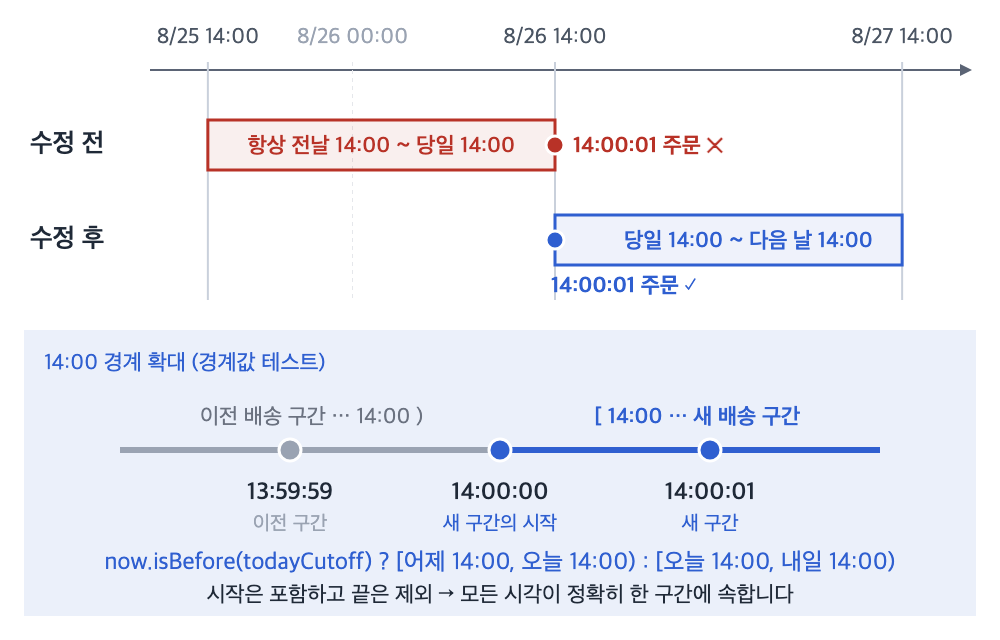

# ☕ Grids & Circles

**원두 주문·관리 서비스(Spring Boot · Next.js)에서 주문 생성·병합, 관리자 매출 통계, 공통 오류 규격을 구현하고 팀장을 맡은 프로젝트입니다.**
경계값 테스트로 "오후 2시 합배송" 구간 계산 결함을 찾아 고쳤고, 본인 담당 테스트 32개가 모두 통과합니다(2026-10-26 재실행).

🔗 [배포 서비스](https://nbe-14-1-yukgaejang-1.vercel.app/) · [관리자 페이지](https://nbe-14-1-yukgaejang-1.vercel.app/admin)

## 👤 담당 역할 및 주요 구현

| 구분 | 구현 내용 | 위치 |
| --- | --- | --- |
| 주문 도메인 | `Order`·`OrderItem` 연관관계, 주문 생성과 초기 병합 흐름, 동일 상품 수량 합산 | `OrderService.createOrder`, `Order`, `OrderItem` |
| 배송 구간 검증 | 시간 계산을 공통 유틸로 분리하자고 제안하고, 경계값 테스트 5개로 14시 이후 구간 계산 결함을 찾아 수정 | `BatchTimeWindowUtil`, `BatchTimeWindowUtilTest` |
| 공통 오류 규격 | 문자열로 흩어진 오류 코드를 `ErrorCode` enum으로 모으고, 모든 오류 응답을 `{code, message, timestamp}`로 통일 | `ErrorCode`, `ApiException`, `GlobalExceptionHandler` |
| 관리자 통계 | JPQL `SUM`·`GROUP BY`·Projection으로 일별·월별 매출과 판매량 상위 상품을 DB에서 집계 | `StatisticsService`, `OrderItemRepository` |
| 테스트 | 주문·배송 구간·통계 테스트 7개 파일, 32개 (단위·통합·MySQL 호환성 분리) | `backend/src/test/.../order`, `global/util` |
| 프런트엔드 보완 | 통계 대시보드 API 연동, API 주소 환경변수화, 목록의 로딩·오류·빈 상태 처리, `Suspense` 빌드 오류 수정 | `frontend/app/admin/statistics` 등 |
| 팀 운영 | 팀장. 역할·우선순위 조정, 회의 시간 상한 운영, README·API 명세·QA 항목 정리 | |

## 🏗️ 시스템 아키텍처

Controller–Service–Repository 계층으로 나누고, 주문 병합과 배송 구간 정책은 Service에, 매출 집계는 Repository의 JPQL에 두었습니다. 계층별 상세는 [아키텍처 문서](docs/ARCHITECTURE.md)에 있습니다.

## 📡 주요 API

Base URL `/api/v1` · 오류 응답은 모두 `{code, message, timestamp}` 형식입니다.

| Method | Endpoint | 설명 |
| --- | --- | --- |
| `POST` | `/orders` | 신규 주문 생성 또는 같은 배송 구간의 기존 주문에 병합 |
| `GET` | `/admin/statistics/revenue/daily` | 일별 매출 |
| `GET` | `/admin/statistics/revenue/monthly` | 월별 매출 |
| `GET` | `/admin/statistics/top-products?limit=3` | 판매량 상위 상품 |

전체 API는 [Notion API 명세서](https://app.notion.com/p/acb15a01205483acb54f0127f1fcaaa2)와 [원본 README](docs/SETUP.md#api)에 있습니다.

## 🔧 트러블슈팅

### 1. 14시 이후 주문이 이미 끝난 배송 구간으로 계산된다

- **문제**: 같은 배송 구간(전날 14시 ~ 당일 14시)의 주문은 하나로 병합합니다. 그런데 최초 `BatchTimeWindowUtil`은 입력 시각과 상관없이 항상 "전날 14:00 ~ 당일 14:00"을 반환했습니다. 그래서 14시 이후 주문도 이미 끝난 구간에서 기존 주문을 찾을 수 있었습니다.
- **발견**: 14:00:01 경계값 테스트에서 기대한 구간 시작은 `2026-08-26T14:00`이었지만 실제로는 `2026-08-25T14:00`이었습니다. 계산된 구간 안에 입력 시각 자신이 들어 있지 않았습니다.
- **선택**: 구간을 `[start, end)`(시작 포함, 끝 제외)로 정의하고, 입력 시각이 당일 14시 이전인지 `isBefore(todayCutoff)`로 나눠 이전 구간과 새 구간을 반환하게 고쳤습니다. 14:00:00은 새 구간의 시작입니다.
- **검토한 대안**: 회의에서는 구간 끝을 13:59:59로 두는 안도 있었습니다. 그러나 시간 정밀도가 밀리초·나노초로 내려가면 그 사이에 빈틈이 생기므로, 다음 구간의 시작을 끝값으로 쓰는 방식을 골랐습니다.

  

- **검증**: 13:59:59, 14:00:00, 14:00:01, 자정 직후, 인자 없는 호출(현재 시각)의 5개 테스트로 규칙을 고정했습니다. 테스트 PR(#55)은 팀원 4명, 수정 PR(#59)은 3명의 승인을 받았습니다.
- **역할 구분**: 유틸리티의 최초 구현은 김영우 팀원이 했고, 본인은 유틸 분리 제안, 경계값 테스트, 결함 수정을 맡았습니다.

### 2. 테스트 클래스의 `@Transactional`이 롤백 검증을 가렸다

- **문제**: 여러 상품 중 하나가 없을 때 앞에서 처리한 주문까지 실제 DB에서 롤백되는지는 Mockito로 증명할 수 없었습니다. `@SpringBootTest`를 추가했지만, 클래스 수준 `@Transactional` 때문에 서비스 트랜잭션이 테스트 트랜잭션에 합류해 롤백 시점이 가려졌습니다.
- **선택**: 클래스 수준 트랜잭션을 지우고, 저장 확인이 필요한 테스트에만 메서드 수준으로 적용했습니다.
- **검증**: 예외가 난 뒤 주문 데이터가 남지 않는 것을 `OrderServiceIntegrationTest`로 확인했습니다.

### 3. H2와 MySQL의 날짜 함수 차이

- **문제**: 일별 매출 쿼리의 MySQL `DATE()` 함수가 H2에서 `Function "DATE" not found`로 실패했습니다.
- **선택**: `cast(orderDate as LocalDate)`로 바꿔 Hibernate가 DB에 맞는 SQL을 만들게 하고, H2 Repository 테스트와 MySQL Testcontainers 테스트를 분리했습니다.
- **검증**: 당시에는 Docker가 없어 MySQL 테스트가 건너뛰어졌습니다. 2026-10-26 재실행에서 `mysql:8.4` 컨테이너로 통과를 확인했습니다.

### 테스트 실행 결과

| 항목 | 방식 | 결과 | 조건 / 출처 |
| --- | --- | --- | --- |
| 배송 구간 경계 | 단위 테스트 | 5 / 5 통과 | `BatchTimeWindowUtilTest` |
| 본인 담당 테스트 | 단위·통합·Repository | 32 / 32 통과 | 주문·통계·배송 구간 7개 클래스 |
| MySQL 통계 쿼리 | Testcontainers `mysql:8.4` | 1 / 1 통과 | `OrderItemRepositoryMySqlIntegrationTest` |
| 백엔드 전체 | `./gradlew clean test` | 60 / 62 통과, 2건 실패 | 실패는 `ProductServiceTest` 정렬 기본값 2건 (아래 한계 참고) |

공통 조건: 2026-10-26, JDK 25(GraalVM), Docker 29.6.1, fork `dev` 브랜치 기준 1회 실행했습니다. 프로젝트 당시(2026-08-28) 로컬 기록은 62개 통과·MySQL 테스트 1개 건너뜀이었습니다.

### 내가 틀렸던 순간

처음 작성한 주문 병합 테스트는 빈 주문에서 시작해서, "이미 같은 상품이 있으면 수량을 합산한다"는 분기를 한 번도 지나지 않았습니다. 구현이 틀려도 통과하는 테스트였습니다. `ReflectionTestUtils`로 상품 식별자를 넣고 같은 상품이 이미 담긴 주문에서 시작하도록 바꾼 뒤, 수량이 합산되고 주문 항목 수는 늘지 않는지까지 확인했습니다.

## 🔍 한계와 개선 방향

| 한계 | 개선 방향 |
| --- | --- |
| `OrderItem`에 주문 당시 단가를 저장하지 않아, 상품 가격을 바꾸면 과거 매출 통계도 바뀝니다 | 주문 시점 단가 저장 + "가격 변경 후에도 과거 매출 불변" 테스트 |
| 유틸은 `[start, end)`인데 기존 주문 조회는 양 끝을 포함하는 Spring Data `Between`을 씁니다 | `>= start AND < end` 조회로 바꾸고 14:00 정각 데이터를 넣은 통합 테스트 추가 |
| 같은 고객의 동시 주문에서 `Order`가 두 개 생길 수 있지만 검증하지 않았습니다 | 동시성 테스트로 먼저 재현한 뒤 유니크 제약·재시도·락 비교 |
| 상품 기본 정렬이 PR #152에서 `DESC`로 바뀌었지만 테스트는 `ASC`를 기대해 2건이 실패합니다 | API 명세·Service 기본값·테스트를 하나의 계약으로 관리하고 CI에서 테스트를 병합 필수 검사로 지정 |
| 관리자 API에 인증·인가가 없고, 운영 DB·CORS 설정이 코드에 섞여 있습니다 | 관리자 인증 추가, 프로파일별 설정 분리 |

## 📋 프로젝트 정보

| 항목 | 내용 |
| --- | --- |
| 과정 | 프로그래머스 백엔드 데브코스 1차 팀 프로젝트 |
| 기간 | 2026.08.24 ~ 2026.08.31 (5명) |
| 원본 레포 | [prgrms-be-devcourse/NBE-14-1-YUKGAEJANG](https://github.com/prgrms-be-devcourse/NBE-14-1-YUKGAEJANG) |
| 원본 README | [팀 README](https://github.com/prgrms-be-devcourse/NBE-14-1-YUKGAEJANG#readme) (전체 기능·API·실행 방법) · [이 레포 보존본](docs/SETUP.md) |
| 데이터 모델 | [ERD](docs/ERD.md) |

| 구성원 | 담당 |
| --- | --- |
| **이태호 (팀장)** | **주문 생성·병합, 통계 집계·대시보드, 공통 오류 규격, Order·Global 테스트** |
| 한종연 | 상품 목록, 정렬·페이지네이션, Product 테스트 |
| 송혜민 | 주문 목록, 이메일 조회, 주문 검색, 공통 예외 처리 |
| 이제혁 | 상품 등록·이미지, 관리자 상품 등록 화면 |
| 김영우 | 상품·주문 삭제, 마감 시간 유틸, 관리자 화면 및 API 연동 |

## 🤝 협업과 피드백

| 구분 | 내용 |
| --- | --- |
| 팀원 피어리뷰 | 기술 역량 4.75 · 협업·참여 태도·수행 역량 각 5.0 (팀원 4명 응답) |
| 동료 평가 | 진행이 느려질 때 역할을 빠르게 재분배하는 팀장, 문서화·테스트·공통 작업을 먼저 맡는 사람 |
| 보완 의견 | 일정이 촉박해도 PR 승인과 검토에 더 무게를 두면 좋겠다는 의견 1건 → 기능 완료 시각과 리뷰 완료 시각을 일정에서 분리하기로 했습니다 |
| 강사 피드백 | 오후 2시 합배송 규칙을 사용자 관점에서 검증한 점, H2·MySQL 차이를 별도 테스트로 다룬 점이 좋게 언급됐고, 주문 당시 가격을 저장하지 않은 설계는 개선 사항으로 지적받았습니다 |

## 🛠️ 기술 스택

| 영역 | 기술 |
| --- | --- |
| Backend | Java 25, Spring Boot 4.1.1, Spring MVC, Spring Data JPA |
| Database | H2 (Local·Test), MySQL 8.4 (Testcontainers 호환성 검증) |
| Test | JUnit 5, AssertJ, Mockito, Spring Boot Test, Testcontainers |
| Frontend | Next.js 16, React 19, TypeScript, Tailwind CSS 4 |
| Deploy | Vercel (Frontend), Railway (Backend) |
| Collaboration | GitHub (feature → dev PR, 2인 이상 승인), Notion, Postman |
