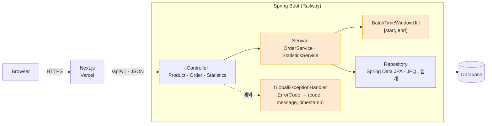

# 시스템 아키텍처

- Controller는 요청 검증과 HTTP 응답, Service는 주문 병합·배송 구간·통계 정책, Repository는 영속화와 DB 집계를 맡습니다.
- 주황색이 본인 담당 영역입니다. `BatchTimeWindowUtil`의 최초 구현은 다른 팀원이 했고, 본인은 경계값 테스트와 구간 계산 수정을 맡았습니다.
- 레포의 `application.yaml`에는 H2 파일 DB(`MODE=MySQL`) 설정만 있습니다. 통계 쿼리는 MySQL 8.4 Testcontainers 테스트로 호환성을 따로 검증했습니다.
- CORS 허용 주소: `http://localhost:3000`, Vercel 배포 주소 ([`WebConfig.java`](../backend/src/main/java/com/yukgaejang/cafemenu/global/configure/WebConfig.java))
