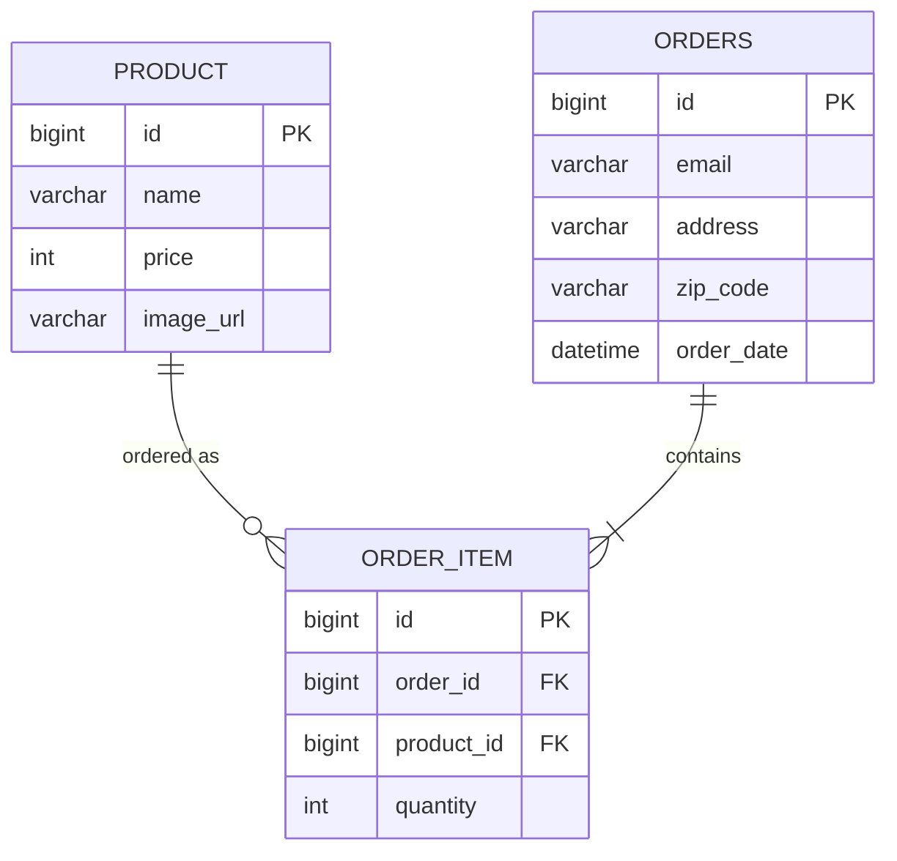

# ERD

- `Order`가 `OrderItem`의 생명주기를 관리합니다(`cascade = ALL`, `orphanRemoval = true`).
- 같은 배송 구간에서 `email`·`address`·`zip_code`가 같은 주문은 하나의 `Order`로 병합하고, 같은 상품이면 새 `OrderItem`을 만들지 않고 `quantity`를 합산합니다.
- `OrderItem`에는 주문 당시 단가가 없습니다. 상품 가격이 바뀌면 과거 매출 통계도 함께 바뀌는 한계가 있습니다.

엔티티: [`Order.java`](../backend/src/main/java/com/yukgaejang/cafemenu/domain/post/order/entity/Order.java), [`OrderItem.java`](../backend/src/main/java/com/yukgaejang/cafemenu/domain/post/order/entity/OrderItem.java)
